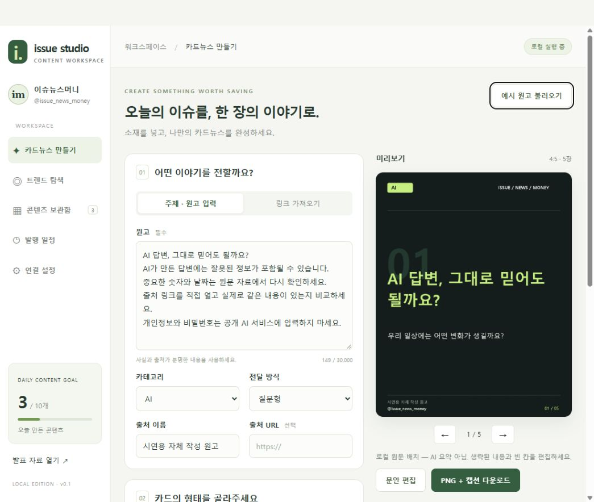

# Issue Studio — 이슈뉴스머니 카드뉴스 제작실

**[웹 체험판 열기](https://reco5149-art.github.io/issue-news-money-studio/)** — PC 서버 없이 원고 배치·카드 편집·PNG/캡션 다운로드를 체험할 수 있습니다. AI 생성·뉴스 검색·인스타그램 게시 기능은 체험판에 포함하지 않습니다.

로컬 자동 복구 설치: PowerShell에서 `./scripts/install-server-watchdog.ps1`. 로그인 후 서버가 자동 실행되며, 서버 리스너가 없으면 30초 간격으로 복구합니다. 자세한 범위는 [운영 안내](DevelopDoc/AVAILABILITY.md)를 참고하세요.

`@issue_news_money`를 위한 **소재 탐색 → 카드 제작 → 검토 → 예약 발행** 프로그램입니다.
한국어 원고로 1~10장 카드뉴스를 만들고 PNG 이미지, 캡션, 편집 정보를 ZIP으로 저장합니다.

> 운영 기능 정리: **2026년 10월 23일**. 로컬 제작·검수·예약 게시와 공개 이미지 연결 복구를 지원합니다.
> 실제 계정의 제작·게시 확인 기록은 [테스트 결과](DevelopDoc/TEST_REPORT.md)에 있습니다. 새 설치에서는 본인의 API·계정·미디어 연결을 별도로 검증해야 합니다.

저장소: https://github.com/reco5149-art/issue-news-money-studio



## 바로 실행

Windows에서 Python 3.12 이상을 설치한 뒤 **`start.bat`를 더블 클릭**하세요.
첫 실행에는 필요한 패키지를 설치하므로 인터넷이 필요합니다.

브라우저에서 **http://127.0.0.1:8765** 에 접속합니다.

```powershell
python -m venv .venv
.\.venv\Scripts\python.exe -m pip install -r requirements.txt
.\.venv\Scripts\python.exe -m uvicorn app.main:app --host 127.0.0.1 --port 8765
```

`start.bat`은 서버를 백그라운드로 실행하고 브라우저를 엽니다. 실행 창을 닫아도 서버는 유지됩니다.
이미 실행 중이면 새 서버를 만들지 않습니다. 종료할 때는 `stop.bat`을 실행하세요.
자동 복구를 설치하지 않았다면 PC 재부팅 후 `start.bat`을 다시 실행해야 합니다. 설치했다면 Windows 로그인 후 감시기가 서버를 실행합니다. 서버는 **1개 프로세스**로 실행하세요.
위 터미널 명령으로 직접 실행했다면 해당 터미널을 닫을 때 서버도 종료됩니다.
오류 기록은 `data/server.stderr.log`에서 확인할 수 있습니다.
현재 URL은 같은 PC에서 사용하는 주소이며, 인터넷 공개 체험 URL이 아닙니다.

## 3분 시연

1. `예시 원고 불러오기`를 클릭합니다. 실제 속보가 아닌 자체 작성 시연 원고입니다.
2. 장수 5장, 비율 4:5, 로컬 원문 배치, 자체 디자인을 선택합니다.
3. `카드뉴스 생성하기` → 미리보기에서 카드를 넘깁니다.
4. `문안 편집`에서 제목을 바꾸고 저장합니다.
5. `PNG + 캡션 다운로드`로 ZIP을 저장합니다.
6. 보관함, 발행 일정, 연결 설정을 보여줍니다. 미연결 기능은 미연결 상태 그대로 설명합니다.
7. 발표자료와 발표 대본은 로컬 전용이며 공개 저장소에는 포함하지 않습니다.

## 기능과 현재 지원 범위

| 기능 | 현재 구현 | 필요한 연결 / 한계 |
|---|---|---|
| 원고 → 카드 | 원문 문장 배치, 편집, CTA, 캡션 | 로컬 모드는 AI 요약이 아닙니다. 생략·빈 칸 검토 필요 |
| AI 요약·후킹 | OpenAI Responses 구조화 응답 | OpenAI API 키, 이용 가능한 모델, 별도 API 요금 |
| 장수·비율 | 1~10장, 자동 장수, 4:5·1:1·9:16 | 9:16은 파일 저장용, 인스타 피드 예약 제외 |
| 뉴스·블로그 URL | 공개 HTML 본문 추출 | 차단·유료·자바스크립트 전용 페이지는 원고 붙여넣기 |
| YouTube URL | 메타데이터, yt-dlp 기반 자막·음성 전사·장면 캡처 | YouTube API, FFmpeg·yt-dlp, 전사 API 연결. 접근·길이·용량 제한으로 수집 불가할 수 있음 |
| Instagram·TikTok URL | 공개 영상의 원문 추출 시도 및 출처 보존 | 플랫폼 접근 제한·로그인·자막 부재에 따라 실패할 수 있음. 제목만으로 내용을 대체하지 않음 |
| 자체 이미지 | 타이포 디자인 / OpenAI·KIE AI 이미지 생성 | AI 사진에는 생성 표시, 선택한 이미지 API 키·별도 요금 필요 |
| 웹 이미지 | Openverse 검색·선택 | 네트워크 접근, 개별 라이선스·인물 권리 검토 |
| 영상 캡처 | 원본 장면 비교, 확대·크롭, 최종 오버레이 검사 | 원본 보존·핵심 장면 보존 검수. 크롭이 재사용 권한 확보를 의미하지 않음 |
| 트렌드 탐색 | Naver 뉴스, YouTube 인기 차트 | 키 필요. 뉴스는 조회수가 아닌 신선도 기반 점수 |
| 매일 초안 | 한국 시간 일정, 최대 20개, 일일 중복 실행 방지 | 원문·사진·AI 연결 필요. 소재 부족 시 미달 수량 기록 |
| 자동 소재·제작 | 유튜브 업로드 후 12시간 이내·10만 조회 이상, 원문 대조·실제 영상 캡처 | 원문 수집 최대 150회/일·영상별 최대 2회·설정된 생성 한도 유지. 한도·인증 오류 시 중단 |
| 예약 자동 게시 | 단일 이미지/캐러셀, 설정 시 하루 최대 20개, 실제 게시 사이 최소 5분 | Instagram 연결·공개 이미지 일치·게시 승인·최종 검수 필요. 자동 예약을 끈 기본 일일 게시 한도는 10개 |
| 승인된 자동 운영 | 명시적으로 활성화한 정책에 따라 검수를 통과한 새 콘텐츠 예약 | 기존 보류물 일괄 승인 아님. 사용자 승인과 이미지 사용 권한 증거를 별도 기록 |
| 게시 결과 확인 | Instagram ID·permalink·매체 종류·사진 수를 원격 조회 | 결과 불명확 시 확인 필요로 남기며 자동 재게시하지 않음 |
| 연결 복구 | 관리 서버와 이미지 전용 서버·터널 감시, 실제 공개 JPG 바이트 확인 | PC·감시기 실행 필요. Quick Tunnel의 고정 주소·무중단 제공은 보장하지 않음 |

현재 운영 설정은 하루 최대 20건, 06:00부터 90분마다 2건, 게시물 사이 5분입니다. 이 값과 활성화 상태는 로컬 DB에 저장되며 저장소를 복제하는 것만으로 자동 게시가 켜지지 않습니다. 새 설치의 간격 기본값은 10분이며 설정 화면에서 5분 이상으로 선택할 수 있습니다.

새 카드에는 소재에 맞는 후킹과 주된 CTA 하나를 적용하고, 제목 윗줄은 흰색·아랫줄은 노란색으로 렌더링합니다. 캡션에 공개하지 않는 원문 URL·타임코드·검수 근거는 내부 기록으로 보존합니다.

실제 운영 기록과 오프라인 회귀 검사를 구분해 [테스트 결과](DevelopDoc/TEST_REPORT.md)에 기록합니다. 현재 앱은 로컬 전용이며 팀원 로그인·역할별 권한·외부 공동 접속은 아직 구현하지 않았습니다.

## 연결 설정

`.env.example`을 `.env`로 복사하고 필요한 항목을 입력한 뒤 재시작하세요.
키를 채팅, 소스 코드, GitHub에 올리지 마세요. `.env`와 `data/`는 Git에서 제외됩니다.

- `OPENAI_API_KEY`: AI 원고·이미지. 모델은 `OPENAI_TEXT_MODEL`, `OPENAI_IMAGE_MODEL`에서 변경.
- `NAVER_CLIENT_ID`, `NAVER_CLIENT_SECRET`: Naver 뉴스 검색.
- `YOUTUBE_API_KEY`: 영상 제목·설명·조회수 조회.
- `INSTAGRAM_ACCESS_TOKEN`, `INSTAGRAM_USER_ID`: Instagram Login으로 연결한 프로페셔널 계정.
- `PUBLIC_MEDIA_BASE_URL`: 생성된 JPEG를 Meta가 읽을 수 있는 공개 HTTPS 이미지 폴더 URL.
- `META_API_VERSION`: Meta 앱에서 지원되는 Graph API 버전 확인 후 지정.
- `KIE_API_KEY`: 선택적으로 KIE 이미지 생성 사용. 잔액 조회와 실제 유료 생성을 구분.
- `AI_PROVIDER`: 기본 `openai`. 학교 API 연결은 [별도 안내](DevelopDoc/SCHOOL_API.md)를 따르며 개인 유료 API로 자동 전환하지 않음.

세부 내용은 [기술 명세](DevelopDoc/TECH_SPEC.md)를 참고하세요.

## 프로젝트 구성

```text
README.md
DevelopDoc/
  PRD.md
  TECH_SPEC.md
  WORK_UNITS.md
  FINAL_CHECKLIST.md
  DEVELOPMENT_SCHEDULE.md
  TEST_REPORT.md
(로컬 전용 발표자료)/
  index.html
  SPEAKER_NOTES.md
app/              # API, 이미지 렌더러, DB, 외부 서비스, 예약 작업
static/           # 한국어 제작 화면
tests/            # 핵심 동작 회귀 테스트
start.bat
.env.example
requirements.txt
data/             # 실행 시 생성. SQLite, 이미지. Git 제외
```

## 테스트

```powershell
.\.venv\Scripts\python.exe -m pytest -q
node --check static/app.js
```

테스트는 임시 데이터 폴더를 사용하고 실제 인스타그램에 게시하지 않습니다.
운영 자료는 `data/`를 백업하고, 복원할 때 서버를 먼저 종료하세요.

## 개발·제출 문서

- [제품 요구사항](DevelopDoc/PRD.md)
- [기술 명세](DevelopDoc/TECH_SPEC.md)
- [단위 작업 및 완료조건](DevelopDoc/WORK_UNITS.md)
- [최종 완료 체크리스트](DevelopDoc/FINAL_CHECKLIST.md)
- [9/29~10/2 개발 일정](DevelopDoc/DEVELOPMENT_SCHEDULE.md)
- [테스트 결과](DevelopDoc/TEST_REPORT.md)
- [API 키 발급·연결 안내](DevelopDoc/API_SETUP.md)
- [자동 소재·예약·게시 간격](DevelopDoc/POSTING_CADENCE.md)
- [공개 이미지 연결과 장애 복구](DevelopDoc/PUBLIC_MEDIA.md)
- 발표자료·발표 대본은 공개 저장소에서 제외합니다.

## 참고한 공식 문서

- [Meta Instagram API](https://www.postman.com/meta/instagram/documentation/6yqw8pt/instagram-api)
- [YouTube 인기 영상 조회](https://developers.google.com/youtube/v3/docs/videos/list)
- [OpenAI 구조화 출력](https://developers.openai.com/api/docs/guides/structured-outputs)
- [Naver 뉴스 검색 API](https://developers.naver.com/docs/serviceapi/search/news/news.md)

조회수·저장·댓글 성과를 보장하지 않습니다. 사실 확인과 이미지 권리 확인은 운영자가 수행하며,
영상 캡처를 크롭하거나 색상을 바꾸는 것만으로 사용 권한이 생기지는 않습니다.

## 공개 저장소의 정보 보호

실제 API 키, `.env`, 콘텐츠 DB, 생성 이미지·로그, 발표자료는 저장소에 포함하지 않습니다.
`.env.example`의 빈 항목에 본인 키를 로컬에서 설정하세요. 이 저장소 공개는 앱 서버 공개나 인스타그램 계정 접근 권한 공유를 의미하지 않습니다.
